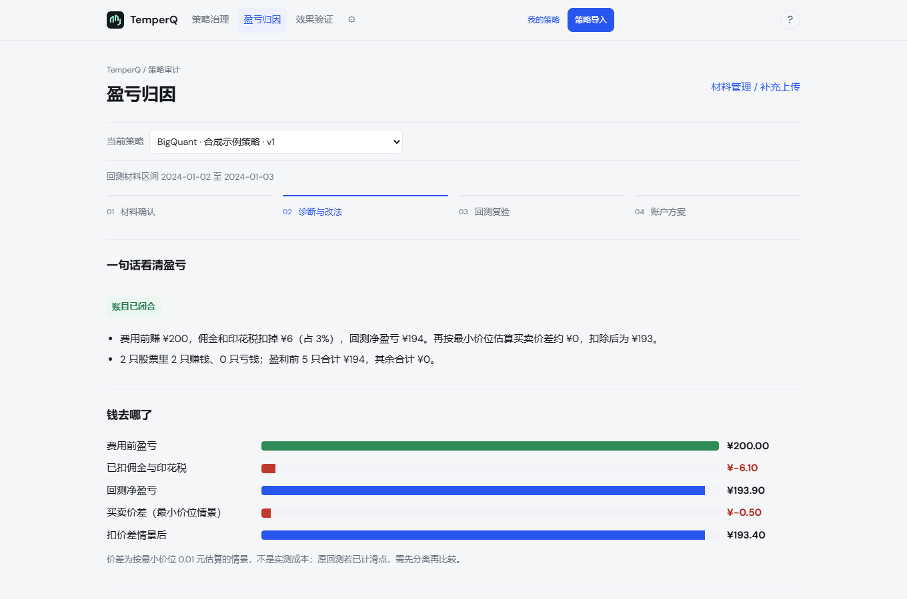

<div align="center">


# TemperQ

**量化回测独立审计 · Independent Backtest Audit for A-Share Strategies**

把平台导出的回测交给 TemperQ，得到一份可复算的审计报告：<br>
账目是否闭合、利润从哪里来、哪些假设撑不住、下一步该改什么。

[](https://github.com/val1813/temperq/actions/workflows/ci.yml)
[](LICENSE)


[快速开始](#快速开始) · [审计范围](#审计范围) · [报告示例](#报告结构) · [方法与原则](#方法与原则) · [English](README.en.md)

</div>

---

## 为什么需要审计回测

一条漂亮的回测曲线，通常同时包含三样东西：策略真实的选股能力、回测引擎的成交假设，以及这段历史恰好给的运气。平台报告只给出合在一起的结果。

TemperQ 只读取回测的**输出**（成交、持仓、账户、日志与策略代码），逐日重建账本，再逐环节检查，把这三样东西尽量拆开，并明确告诉你哪些能确认、哪些不能。

- **本地运行**：全部材料与报告只保存在你的电脑上，服务只监听 `127.0.0.1`。
- **不执行代码**：策略代码只做只读的语法解析，从不导入或运行。
- **不提供数据**：只审计你上传的材料，不下载、不补齐任何行情或基准。
- **结论可复算**：每份报告附带全部输入、中间结果和哈希，同一份材料任何时候重跑都得到同一份报告。

## 快速开始

支持 Windows 10/11 与 Linux，CPU 即可，建议 8GB 以上内存。

**Windows**

1. 安装 [uv](https://docs.astral.sh/uv/getting-started/installation/)。
2. [下载源码](https://github.com/val1813/temperq/archive/refs/heads/main.zip) 并解压。
3. 双击 `install.bat` 完成安装。
4. 双击 `start.bat`，浏览器自动打开审计页面。

**Linux**

```bash
git clone https://github.com/val1813/temperq.git
cd temperq
sh install.sh
sh start.sh
```

默认地址 `http://127.0.0.1:8765`。没有自己的回测时，可在页面下载合成示例先走一遍。

## 两种使用方式

| 模式 | 上传什么 | 得到什么 |
| --- | --- | --- |
| **审计一份回测** | 策略代码 + 1 至 5 个时期的回测导出（ZIP 无需解压） | 每期一份完整审计报告；多期时附横向对比 |
| **比较原版与修改版** | 改动前后、同一时期的两次回测 | 按同一成本口径重算后的对比报告：修改是否值得保留 |

提交后直接生成报告，没有中间确认页。材料不全时，报告会写明哪些项目无法审计、补什么材料可以审计。

## 审计范围

| 层次 | 检查内容 | 所需材料 |
| --- | --- | --- |
| **账目** | 现金、持仓、成交、费用逐日闭合；与平台自报收益和回撤对照 | 成交、每日持仓、账户汇总 |
| **成本** | 佣金、最低佣金、历史印花税；小额交易摩擦；最小报价单位价差情景 | 成交 |
| **盈亏归因** | 逐标的净贡献、费用占比、最大回撤期间的亏损来源、持有期分组 | 成交、持仓 |
| **执行** | 成交量参与率、同分钟换仓的资金依赖、部分成交未补单、封板日成交、成交时点敏感性 | 委托、分钟行情、涨跌停价 |
| **信号** | 排序信号与后续收益的关系（带 HAC 标准误）、第一名相对候选池、信号时序与未来函数 | 每日排名、候选池收盘价 |
| **样本** | 上市前或退市后记录、幸存者偏差提示、回测长度是否足以下结论 | 上市退市日期 |
| **版本比较** | 原版与修改版、两项改动能否叠加、同一策略多时期一致性 | 两套或四套同口径回测 |

基础审计只需要平台的标准导出。每日排名、分钟行情等补充材料，可用仓库提供的 [`temperq_recorder.py`](src/qwb/static/temperq_recorder.py) 与 [`temperq_supplement.py`](src/qwb/static/temperq_supplement.py) 在原平台生成。

### 支持的平台

| 平台 | 提交方式 |
| --- | --- |
| BigQuant | 回测结果页导出交易、持仓、日志，连同策略代码上传 |
| 聚宽 | 在研究环境运行 [导出脚本](src/qwb/static/joinquant_export.py)，上传生成的 ZIP |
| 米筐 / RQAlpha | 上传回测报告目录中的 CSV 或其 ZIP |
| 其他平台 | 按 [通用格式](docs/STRATEGY_AUDIT_FORMAT.md) 整理为交易、持仓、账户三张表 |

当前覆盖 A 股股票、ETF/基金与可转债的多头策略。

## 报告结构

报告第一屏只回答三个问题：

| 问题 | 回答方式 |
| --- | --- |
| **收益能信吗** | 账目是否闭合；成交量、资金衔接等是否让回测价格在实盘中难以实现 |
| **钱花在哪了** | 费用占费用前盈利的比例；亏损集中在哪些标的、哪段时间 |
| **先做什么** | 一至两项可执行的复跑建议，例如降低本金重跑、与等权对照比较 |

正文依次为业绩与风险、盈亏归因、发现与处理、范围与证据。技术明细默认折叠，可打印为一页体检单或完整 PDF。

<p align="center">
  
</p>
<p align="center"><sub>盈亏归因页（内置合成示例，仅展示界面）</sub></p>

## 方法与原则

- **先对账，再下结论。** 账目未闭合的环节只标“待核对”，不出结论。
- **证据分级。** 账目复算、事后描述、情景估计、同区间复跑分别标注；不把情景当事实，不把样本内当样本外。
- **规则有出处。** 交易所规则、税率、统计方法与经验阈值分开登记，经验阈值明确标注，可自行调整。见 [审计规则](docs/AUDIT_RULES.md)。
- **不夸大检出能力。** 在三轮预注册盲测中（检测方只拿到模拟器，评分规则事先锁定），第三轮对未见过的缺陷检出 37/58，无缺陷样本中 13/60 出现处理提示。审计用于发现可疑之处，不保证找出全部问题。
- **不预测收益。** 所有结论只描述所提交的历史回测，不构成投资建议，也不代表未来表现。

## 命令行

```bash
qwb audit check  <回测导出目录>                      # 识别材料、核对账目
qwb audit run    <回测导出目录> --out <输出目录>       # 生成 report.html、evidence.json 与明细 CSV
qwb audit compare <原版输出> <修改版输出>              # 同一口径比较两个版本
qwb audit interaction <原版> <只改A> <只改B> <都改>    # 两项改动能否叠加
```

完整命令见 `qwb audit --help`。

## 文档

- [导入格式](docs/STRATEGY_AUDIT_FORMAT.md)：各平台导出方法与通用字段
- [审计规则](docs/AUDIT_RULES.md)：每条规则、方法与阈值的出处
- [设计原则](docs/WHY_THIS_DESIGN.md)：为什么只审输出、不运行代码
- [常见陷阱](docs/PITFALLS.md)：前视、隔夜跳空、把预测指标当收益
- [金额归属](docs/AUDIT_MONETARY_IMPACT.md)：报告中各类金额的含义
- [开发说明](docs/DEVELOPMENT.md)：项目结构与测试

## 反馈

欢迎通过 [Issues](https://github.com/val1813/temperq/issues) 报告问题或提出平台适配需求；提交时请附脱敏后的导出表头。

联系：val9281@qq.com

## 许可

代码采用 [AGPL-3.0](LICENSE) 许可，版权所有 © 2026 val1813。第三方组件遵循各自许可，见 [NOTICE](NOTICE)。

本项目用于研究与学习，不提供投资建议、策略代运营或实盘交易服务。
